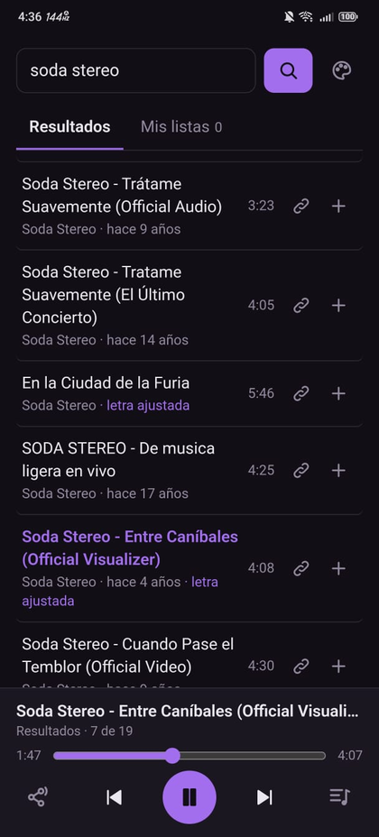
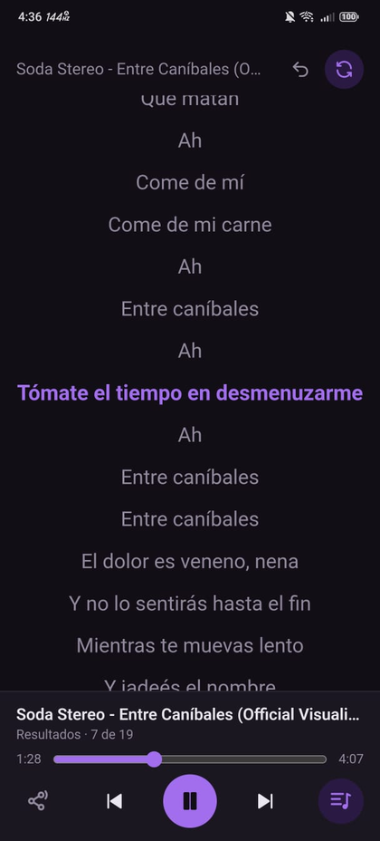
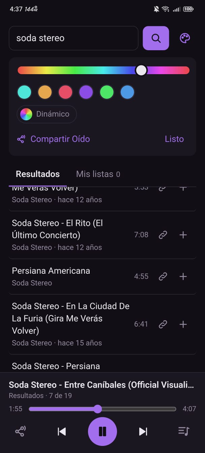
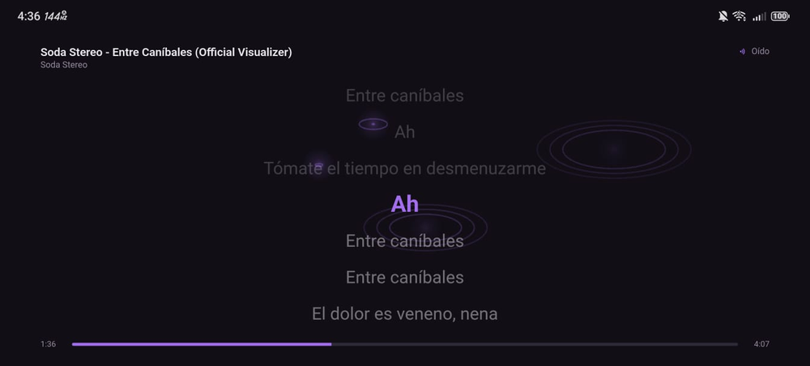

  

<h1 align="center">Oído</h1>

  Escucha YouTube sin anuncios, con la pantalla apagada, con letras y tus propias listas.

  <a href="https://github.com/KALAVER084/oido/releases/latest"><b>⬇️ Descargar la última versión (APK)</b></a>

---

## Capturas

  
  &nbsp;
  
  &nbsp;
  

  

Búsqueda y reproductor · Letra sincronizada · Tema de colores · Modo karaoke

---

## Qué hace

Oído hace una sola cosa: **buscar en YouTube y reproducir solo el audio**.

- **Búsqueda completa:** audios, mixes y listas de reproducción, con filtros y orden por fecha (útil para podcasts).
- **Segundo plano real:** sigue sonando con la pantalla apagada o la app cerrada, con controles en la notificación, la pantalla de bloqueo, audífonos Bluetooth y el carro.
- **Sin anuncios:** nunca carga páginas ni el reproductor de YouTube; pide el audio directo.
- **Tus listas:** crea, ordena y reproduce listas propias. Guárdalas como copia (por ejemplo en Google Drive) o envíalas por WhatsApp o correo para pasarlas a otro teléfono.
- **Letras sincronizadas:** si la canción tiene letra, la muestra al ritmo de la música, en una franja o a pantalla completa. Si la versión no coincide (en vivo, videoclip con intro), la muestra fija para que nunca vaya desfasada.
- **Modo karaoke:** con una tele conectada (cable, dock o Miracast) la letra aparece en grande en la tele mientras usas el teléfono normal. En el teléfono, gíralo o toca el botón de karaoke (el ícono de un teléfono girando): funciona con cualquier canción, incluso sin letra o en vivo. Toca la pantalla del karaoke para pausar, cambiar de canción o arrastrar la barra de tiempo; doble toque a un lado salta 10 segundos. De fondo, una de **44 animaciones de líneas** que se mueven tranquilas: montañas con luz en las cimas, nubes, mar, viento, ciudades, planetas, túneles y más. Con letra sincronizada, cada verso nuevo entra con un brillo suave. Si la letra de una canción está desfasada y no quieres ajustarla, puedes ocultarla solo para esa canción (desde el panel de la letra o tocando la pantalla del karaoke).
- **En vivo:** transmisiones como Lofi Girl, en la calidad más baja para gastar pocos datos.
- **Compartir:** copia el enlace de cualquier audio, mix o lista.
- **Tema a tu gusto:** eliges un color y la app ajusta fondo, texto y acentos, o activas el modo **Dinámico** para que los colores cambien solos, despacio.
- **Sincroniza tú la letra:** si una letra va desfasada (en vivos o videoclips), la ajustas con un toque y con ajuste fino; la app lo recuerda para ese audio.
- **Se actualiza sola:** te avisa dentro de la app cuando hay versión nueva.
- **En tu idioma:** español, English, Português, Français, Deutsch y 日本語. Toma el idioma del teléfono, o lo eliges en el panel del tema.

## Instalación

1. Desde el teléfono, abre **[la última versión](https://github.com/KALAVER084/oido/releases/latest)** y descarga el archivo `.apk`.
2. Ábrelo. Android te pedirá permitir instalar apps de esa fuente: acéptalo.
3. La primera vez que abras Oído, **permite las notificaciones** (ahí aparecen los controles).

> **Si la música se corta con la pantalla apagada** (pasa en Xiaomi, Huawei, Samsung y otras marcas con ahorro de batería agresivo):
> Ajustes → Apps → Oído → Batería → **Sin restricciones**.

Las versiones nuevas se instalan **encima** de la anterior y conservan tus listas.

## Privacidad

- No hay cuentas, registros ni estadísticas de uso.
- Tus listas y preferencias se guardan solo en tu teléfono.
- La app solo se conecta a YouTube (para buscar y reproducir), a [LRCLIB](https://lrclib.net) (para las letras) y a GitHub (para saber si hay versión nueva).
- Bloqueadores de anuncios de todo el sistema (DNS privado, AdGuard, etc.) funcionan normalmente con ella.

## Cómo funciona por dentro

| Pieza | Qué hace |
|---|---|
| [NewPipe Extractor](https://github.com/TeamNewPipe/NewPipeExtractor) | Habla con YouTube: búsquedas, listas, mixes y la dirección del audio |
| [Media3 / ExoPlayer](https://developer.android.com/media/media3) | Reproduce en segundo plano, con notificación y pantalla de bloqueo |
| [LRCLIB](https://lrclib.net) | Base de datos libre de letras sincronizadas |
| WebView | Dibuja la interfaz (`app/src/main/assets/index.html`) |

## Mantenimiento

Casi todo es automático. Las instrucciones para cuando algo falla están en **[MANTENIMIENTO.md](MANTENIMIENTO.md)**.

## Licencia

Oído usa NewPipe Extractor y código de [NewPipe](https://github.com/TeamNewPipe/NewPipe), que son software libre bajo licencia **GPLv3**, así que Oído también se distribuye bajo **GPLv3**.

Oído no está afiliado a YouTube ni a Google.
